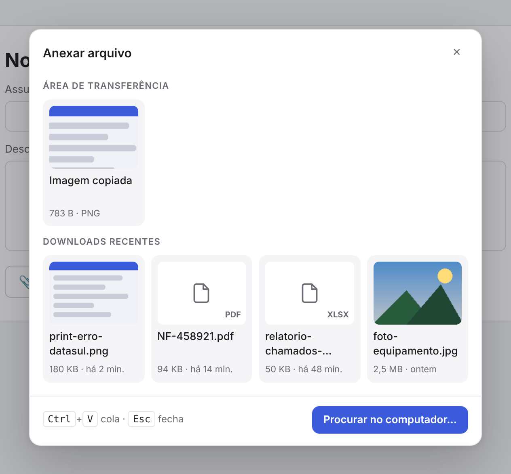
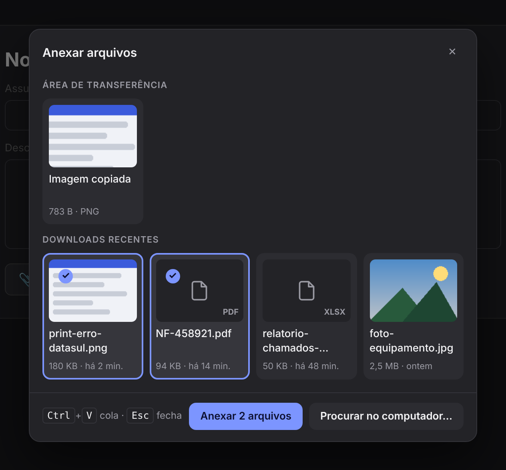

# Uptray

> Opera-like "Easy Files" for Chromium browsers: pick recent downloads or a copied image when uploading a file.

Extensão para navegadores baseados em Chromium (Helium, Chrome, Brave, Edge, Vivaldi) que recria
o **Easy Files** do Opera. Ao clicar para anexar um arquivo em qualquer site, em vez de abrir direto
o Explorer, aparece um popup com a imagem da área de transferência e os downloads recentes.
Precisa de outro arquivo? Um clique em **Procurar no computador…** abre o seletor normal.

  
  

## Recursos

- **Downloads recentes** com miniatura para imagens e ícone do tipo para os demais arquivos.
- **Imagem da área de transferência**: anexe um print sem precisar salvá-lo antes.
- **`Ctrl+V` no popup** cola a imagem ou o arquivo que estiver copiado.
- **Vários arquivos** de uma vez em campos que aceitam múltiplos anexos.
- **Respeita o filtro do site** (atributo `accept`): tipos não aceitos aparecem desabilitados.
- **Tema claro e escuro** automáticos, seguindo o sistema.
- **Liga/desliga por site** e quantidade de downloads exibidos, pelo ícone da extensão.
- **Sem nada para mostrar?** O Explorer abre direto, sem passo extra.

## Instalação

1. Baixe o repositório (**Code → Download ZIP**) e extraia para um lugar fixo
   (ex.: `C:\Ferramentas\uptray`). O navegador carrega a extensão direto dessa pasta,
   então não apague nem mova depois.
2. Abra `chrome://extensions`.
3. Ative o **Modo do desenvolvedor** (canto superior direito).
4. Clique em **Carregar sem compactação** e selecione a pasta.
5. Em **Detalhes** da extensão, confirme que **Permitir acesso a URLs de arquivo** está
   ativado (necessário para anexar os downloads).
6. Se usar vários perfis, repita em cada um: extensões são instaladas por perfil.

## Uso

| Ação | Como |
| --- | --- |
| Anexar um download ou a imagem copiada | Clique no item |
| Anexar vários arquivos | Clique para selecionar e use **Anexar N arquivos** |
| Colar o que está copiado | `Ctrl+V` com o popup aberto |
| Abrir o seletor do sistema | **Procurar no computador…** |
| Fechar sem anexar | `Esc` ou clique fora |

## Como funciona

- `inject.js` roda no contexto da página e intercepta a abertura do seletor de arquivos
  (`input.click()`, `showPicker()` e cliques diretos), inclusive em inputs fora do DOM.
- `content.js` desenha o popup num Shadow DOM isolado do CSS do site e entrega os arquivos
  escolhidos ao input original, disparando os eventos `input` e `change` como o seletor nativo.
- `background.js` lista os downloads com a API `chrome.downloads`, e `offscreen.js` lê os
  arquivos do disco e gera as miniaturas.
- Se a extensão estiver desativada, recarregada ou desligada no site, o seletor nativo abre
  normalmente: nada quebra.

## Limitações conhecidas

- Sites que usam a API `showOpenFilePicker` (alguns editores web) abrem o seletor nativo.
- Downloads apagados ou movidos somem da lista.
- Arquivos acima de 500 MB precisam ser escolhidos pelo Explorer.
- Na primeira vez em alguns sites, o navegador pode pedir permissão para ler a área de transferência.

## Licença

[MIT](LICENSE)
